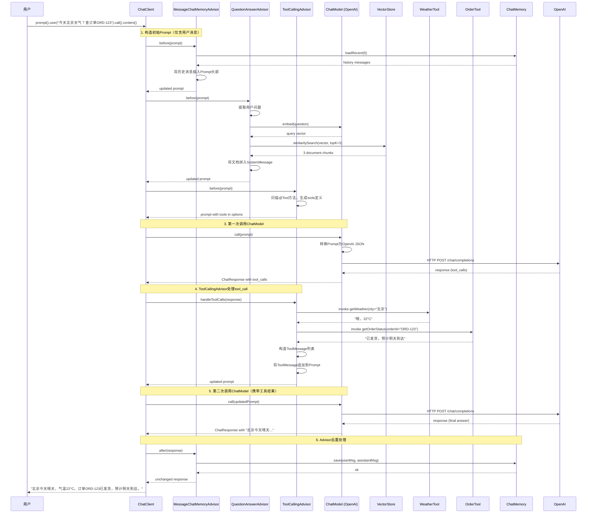

# Spring AI 调用链
{: .no_toc }

## Table of contents
{: .no_toc .text-delta }

1. TOC
{:toc}

---


# 03 · 理解篇：场景与调用过程

> 阶段：理解调用链
> 本篇目标：理解spring ai 完整且覆盖多种场景的调用链过程

---

# 展示一次用户请求从进入 Spring AI 到最终返回的全过程

## 1. 场景覆盖

- 普通对话
- RAG（检索增强生成）
- Tool Calling（工具调用）
- 记忆（ChatMemory）
- 流式与非流式两种模式

为了清晰，采用缩进层级 + 箭头 + 注释的方式，模拟时序图的阅读顺序（从上到下，从左到右表示调用方向）。


## 2. 场景设定

用户提问：

    “今天北京天气怎么样？顺便帮我查一下订单 ORD-123 的状态。”

系统已有：

- WeatherTool（查天气，需调用第三方 API）
- OrderTool（查订单状态，查数据库）
- VectorStore 中存有公司产品手册（RAG 用）
- ChatMemory 存储了最近 10 轮对话

## 2. 场景覆盖的组件

| 组件 | 在本时序图中的角色                     |
|-----|-------------------------------|
|ChatClient	| 入口，组装 Prompt，触发执行             |
|MessageChatMemoryAdvisor	| 注入历史对话，保存新对话                  |
|QuestionAnswerAdvisor	| 执行 RAG 检索，拼入上下文               |
|ToolCallingAdvisor	| 管理工具定义、解析 tool_call、执行工具、二次调用 |
|EmbeddingModel	| 将问题转为向量                       |
|VectorStore	| 存储文档向量，执行相似度搜索                |
|OpenAiChatModel	| 厂商适配，转换消息格式，发起 HTTP 请求        |
|WeatherTool / OrderTool	| 用户自定义 @Tool 方法 |
|ChatMemory	| 存储对话历史（InMemory 或 Redis） |


## 4. 调用时序图

```
用户 HTTP 请求 /ask?q=今天北京天气？查订单ORD-123
  │
  ▼
【ChatClient.prompt().user(...).call().content()】         ← 入口
  │
  ├── 1. 构造 Prompt（UserMessage + 历史记忆？）
  │     └─ 此时 Prompt 内只有当前用户消息
  │
  ├── 2. 【Advisor 链 - 前置处理】
  │     │
  │     ├── 2a. MessageChatMemoryAdvisor.before(prompt)
  │     │     ├─ 从 ChatMemory 加载最近 5 条对话（system/user/assistant）
  │     │     └─ 将历史消息插入 Prompt 头部
  │     │
  │     ├── 2b. QuestionAnswerAdvisor.before(prompt)
  │     │     ├─ 提取用户问题（去除历史干扰）
  │     │     ├─ 调用 EmbeddingModel 将问题转为向量
  │     │     ├─ 调用 VectorStore.similaritySearch(queryVector, topK=3)
  │     │     ├─ 得到 3 个相关文档片段
  │     │     └─ 将文档片段作为 SystemMessage 拼入 Prompt（如：“以下是相关知识：...”）
  │     │
  │     └── 2c. ToolCallingAdvisor.before(prompt)
  │           ├─ 扫描所有 @Tool 方法（WeatherTool.getWeather, OrderTool.getOrderStatus）
  │           ├─ 生成 tools 定义（JSON Schema 数组）
  │           └─ 将 tools 附加到 Prompt 的 options 中
  │
  ├── 3. 【第一次调用 ChatModel】
  │     │
  │     ├── 3a. OpenAiChatModel.call(prompt)
  │     │     ├─ 将 Spring AI 的 Prompt 转为 OpenAI API 请求体（JSON）
  │     │     │   { model: "gpt-4o", messages: [...], tools: [...] }
  │     │     ├─ HTTP POST https://api.openai.com/v1/chat/completions
  │     │     └─ 等待响应（约 1~2 秒）
  │     │
  │     └── 3b. 模型返回响应（非最终回答，而是 tool_call）
  │           ├─ choices[0].message.content = null
  │           ├─ choices[0].message.tool_calls = [
  │           │     { id: "call_xxx", function: { name: "getWeather", arguments: '{"city":"北京"}' } },
  │           │     { id: "call_yyy", function: { name: "getOrderStatus", arguments: '{"orderId":"ORD-123"}' } }
  │           │   ]
  │           └─ finish_reason = "tool_calls"
  │
  ├── 4. 【ToolCallingAdvisor 处理 tool_call】
  │     │
  │     ├── 4a. 遍历 tool_calls
  │     │     ├─ 调用 WeatherTool.getWeather(city="北京") 
  │     │     │     └─ 内部：HTTP 调用天气 API → 返回 "晴，22°C"
  │     │     └─ 调用 OrderTool.getOrderStatus(orderId="ORD-123")
  │     │           └─ 内部：查询数据库 → 返回 "已发货，预计明天到达"
  │     │
  │     ├── 4b. 构造 ToolMessage 列表
  │     │     ├─ ToolMessage(tool_call_id="call_xxx", content="晴，22°C")
  │     │     └─ ToolMessage(tool_call_id="call_yyy", content="已发货，预计明天到达")
  │     │
  │     └── 4c. 将 ToolMessage 追加到 Prompt 中
  │           └─ 新的 Prompt 包含：历史消息 + 原始用户消息 + 工具结果
  │
  ├── 5. 【第二次调用 ChatModel】（携带工具结果）
  │     │
  │     ├── 5a. OpenAiChatModel.call(updatedPrompt)
  │     │     └─ 再次 HTTP POST（同上，但 messages 多了 tool 结果）
  │     │
  │     └── 5b. 模型返回最终回答（finish_reason = "stop"）
  │           └─ content = "北京今天晴天，气温22°C。您的订单 ORD-123 已发货，预计明天送达。"
  │
  ├── 6. 【Advisor 链 - 后置处理】
  │     │
  │     ├── 6a. ToolCallingAdvisor.after(response) — 无操作
  │     ├── 6b. QuestionAnswerAdvisor.after(response) — 无操作
  │     └── 6c. MessageChatMemoryAdvisor.after(response)
  │           └─ 将本次对话（用户消息 + 助手回答）存入 ChatMemory
  │
  └── 7. 【返回结果】
        └─ content() 提取 AssistantMessage.content → "北京今天晴天..."
```

流式模式的区别

如果使用 .stream() 而不是 .call()，流程变化如下：

```
├── 3'. 【第一次调用 ChatModel（流式）】
  │     ├─ 使用 WebClient 发起 SSE 请求
  │     ├─ 逐 chunk 接收 data: {...} 事件
  │     └─ 每收到一个 chunk，就通过 Flux 发射给调用方
  │
  ├── 4'. 【ToolCallingAdvisor 处理 tool_call】
  │     └─ 需要等到所有 chunk 接收完毕，才能判断是否是 tool_call
  │        （因为 tool_call 可能出现在最后一个 chunk 中）
  │
  ├── 5'. 【第二次调用 ChatModel（流式）】
  │     └─ 同样逐 chunk 发射最终回答
  │
  └── 6'. 【Advisor 后置处理】
        └─ 在 Flux 完成时执行（如保存记忆）
```
关键差异：流式模式下，Advisor 的前置处理是一样的，但后置处理需要等到整个 Flux 结束。Tool Calling 的判断需要等待第一个响应的完整 JSON（因为 tool_call 可能在最后一个 delta 中出现）。


总结

{: .tips }
> 一次看似简单的 chatClient.prompt().user(...).call().content()，背后可能经历了 两次甚至多次 LLM 调用，穿插着 向量检索、工具执行、记忆读写，全部由 Spring AI 的 Advisor 链​ 有序编排。这就是它“智能编排”的本质。

